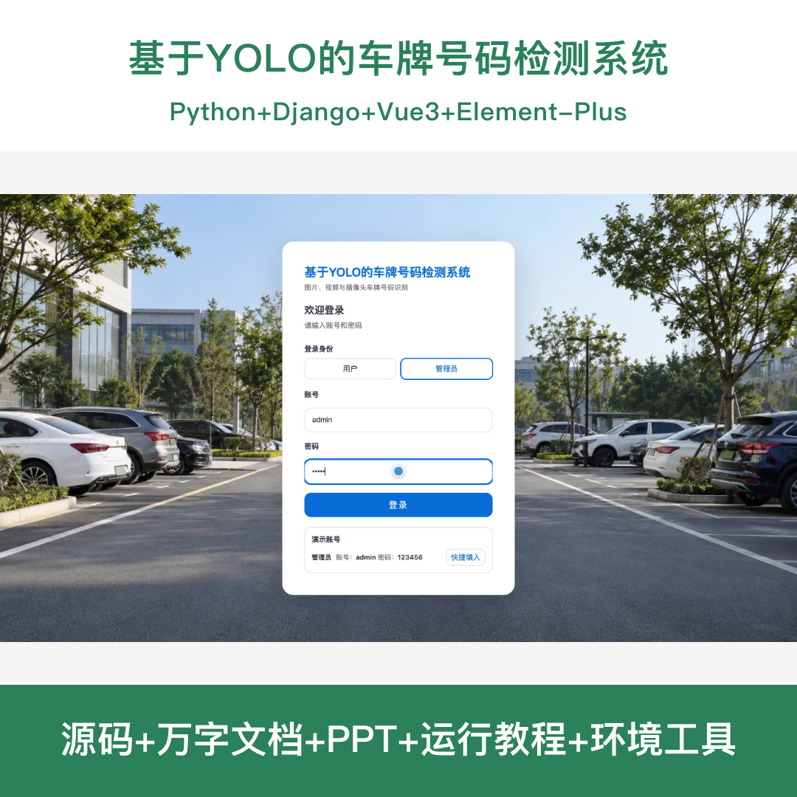
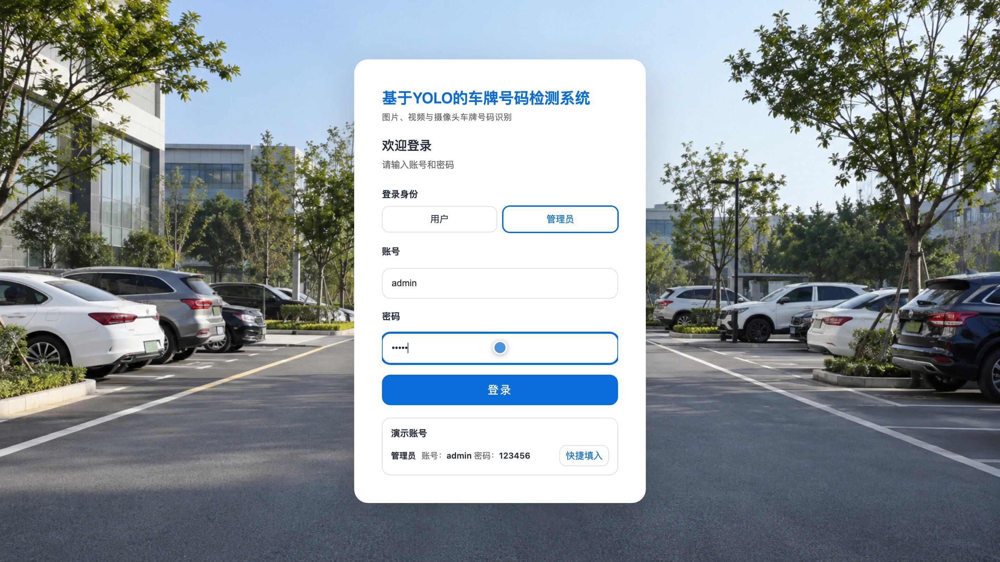
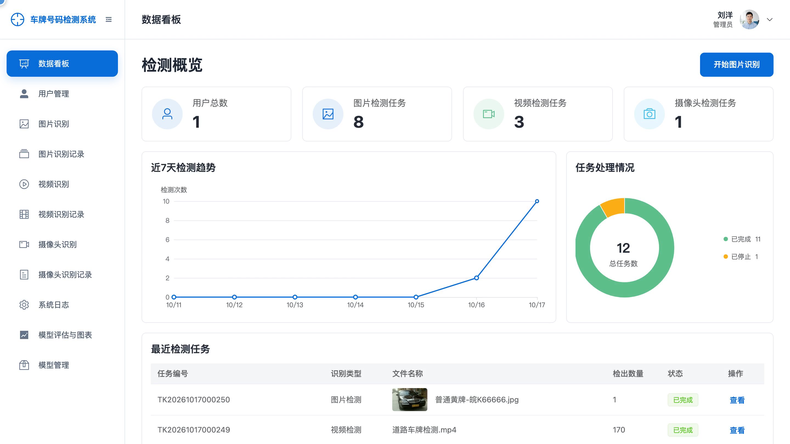
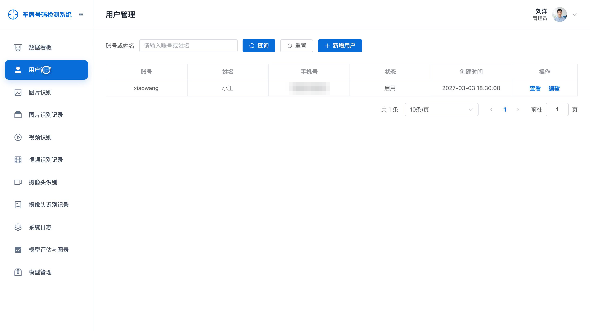
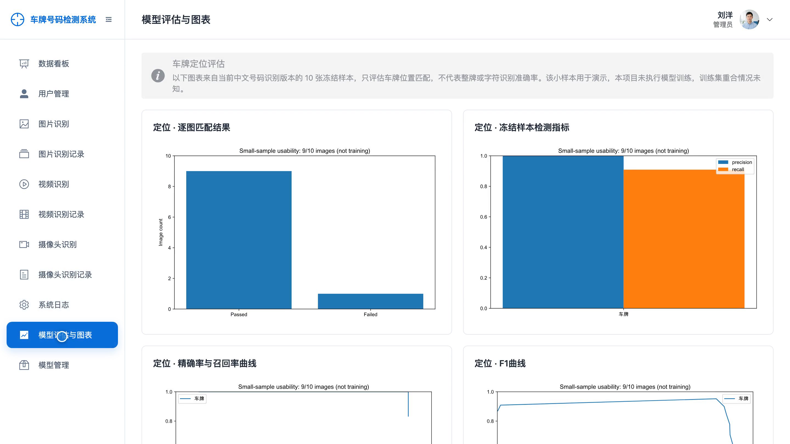
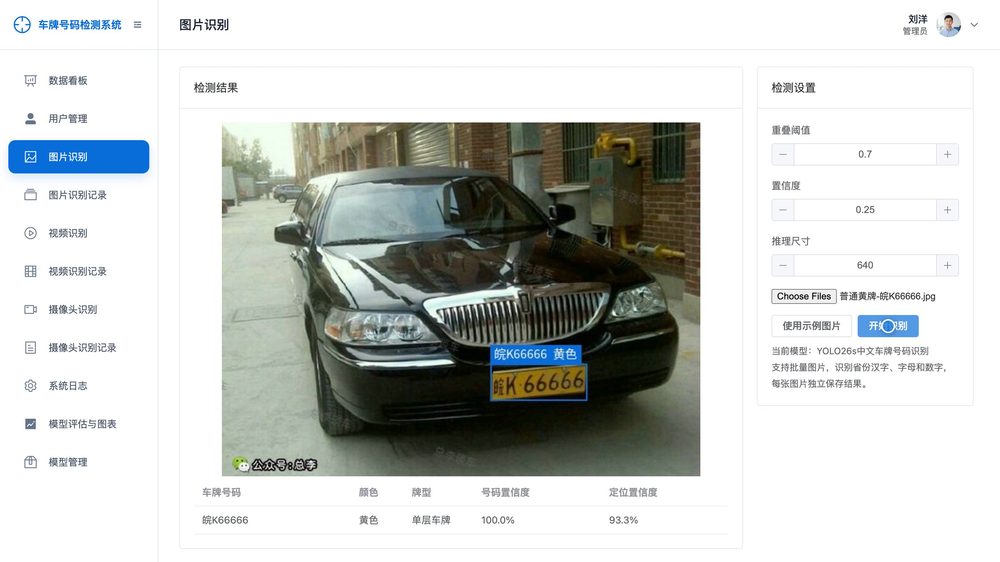
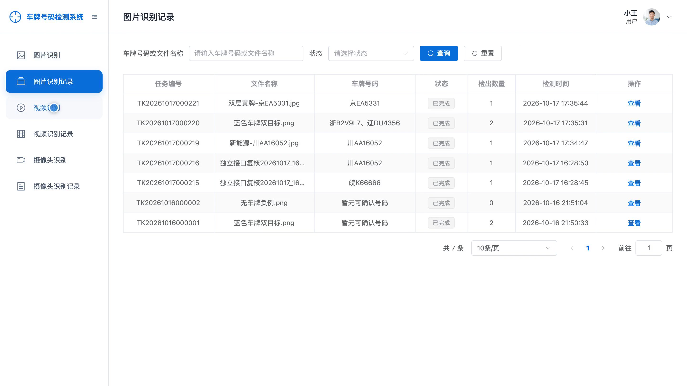
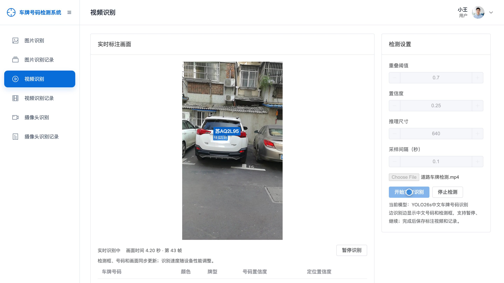
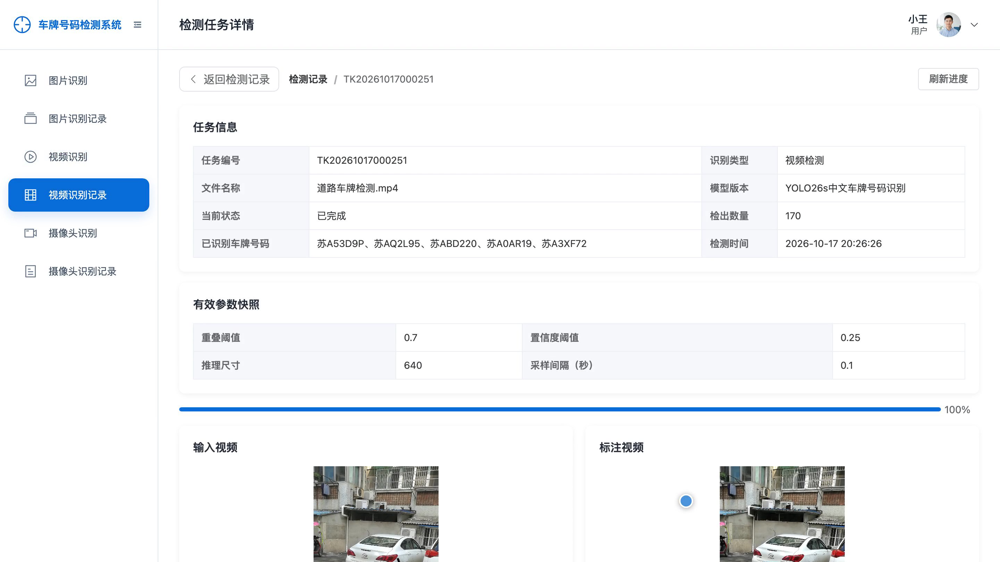

## 源码问题查看主页咨询

### 一、关键词
车牌识别、车牌号码检测、车辆号牌识别、视频车牌检测、摄像头车辆识别

### 二、作品包含
源码+数据库+全套环境和工具资源+本地部署教程

### 三、项目技术
前端技术： Html、Css、Js、Vue3.4、Element-Plus
后端技术：Python、Django、DRF、Ultralytics、PyTorch、OpenCV、YOLO26

### 四、运行环境要求
开发工具：PyCharm + VSCODE

数据库：MySQL5.7+（共8张表）

数据库管理工具：Navicat10以上版本

环境配置软件： Python3.11

前端Nodejs：20.19.5

浏览器：谷歌浏览器

### 五、项目介绍
项目编号：bs171D

系统围绕车辆号牌检测与中文号码识别，提供图片批量识别、视频识别和摄像头识别，支持调整检测参数、实时查看标注画面与任务状态，并保存结果和参数快照。用户查看本人检测记录，管理员统一维护用户、模型、全量任务及评估图表。

角色：用户、管理员

用户功能：账号登录与个人资料维护、单张及批量图片车牌识别、视频车牌检测与中文号码识别、摄像头实时车牌识别、检测参数调整与快照保存、任务暂停与继续和停止、本人图片与视频及摄像头记录查询、标注结果及视频查看。

管理员功能：数据看板与任务趋势统计、用户账号创建与维护与启用管理、图片与视频和摄像头车牌识别、检测参数调整与实时标注查看、任务暂停与继续与停止与结果保存、全量检测记录及系统日志查询、模型登记与验证状态查看与版本切换、模型评估图表查看与个人资料维护。

### 六、运行截图

